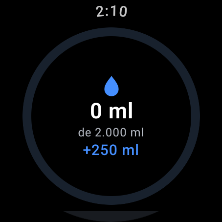
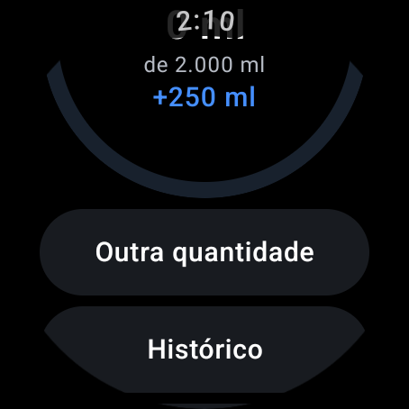
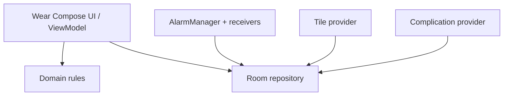

# AquaTicks 💧

**An offline hydration tracker and reminder for Wear OS, designed for a Samsung Galaxy Watch.**

**Source code:** this repository's `main` branch · [Implementation history](https://github.com/luisfelipealves/aquaticks/pull/1) · [CI builds](https://github.com/luisfelipealves/aquaticks/actions/workflows/android.yml)

## Experience

Tap the progress ring to log the default 250 ml, or choose another amount. Set a daily goal, inspect history, use a quick-access Tile and add a progress complication to a compatible watch face. Reminders can use 1–4 hour intervals and quiet hours. They start at the next whole local hour. Data stays on the watch; there is no account, backend, analytics or network permission.



| Home | Actions |
| --- | --- |
|  |  |

*Captured from the current Android build on a disposable Wear OS 4 emulator in CI, with an empty local database. A physical-watch photo is separate from these emulator captures. [Installation and watch testing guide](docs/TESTING.md).*

## Architecture



The single Kotlin app module separates `ui/`, `domain/`, `data/`, `reminders/`, `tile/` and `complication/`. Room stores intake events, settings and daily goal snapshots. Records preserve their UTC instant, original local date and time zone. The reminder scheduler uses a single alarm with recovery on reboot or time changes; the complication responds safely before the first unlock.

## Build and try it

Prerequisites: JDK 17, Android SDK 36, a compatible Gradle installation and a Wear OS 3+ watch or emulator. The branch does not currently commit a Gradle wrapper; consult its CI workflow for the Gradle setup used in cloud builds.

```bash
git clone https://github.com/luisfelipealves/aquaticks.git
cd aquaticks
gradle testDebugUnitTest lintDebug assembleDebug
```

Install `app/build/outputs/apk/debug/app-debug.apk` on the watch using `adb install -r`, or download the APK from a successful CI run. Follow [docs/TESTING.md](https://github.com/luisfelipealves/aquaticks/blob/agent/mvp/docs/TESTING.md) for pairing and physical validation.

## How we built it

I chose the watch interactions and tested reminder timing, notifications and the complication on my device. The assistant helped turn those observations into focused specifications, implementation steps and regression tests. We iterated from the core tracker to history, Tile, complication and reminder recovery, using CI APKs for human acceptance. [Project decisions](https://github.com/luisfelipealves/aquaticks/blob/agent/mvp/docs/PROJECT.md) and [validation notes](https://github.com/luisfelipealves/aquaticks/blob/agent/mvp/docs/VALIDATION.md) capture the tradeoffs.

## Status and portfolio snapshot

The app has been used on a physical watch. Complication appearance after reboot can depend on watch-face host behavior and has shown a delay; physical acceptance is still separate from passing CI. **Highlights:** Kotlin, Wear Compose, Room, AlarmManager, Tile, complication and offline-first time modeling.
